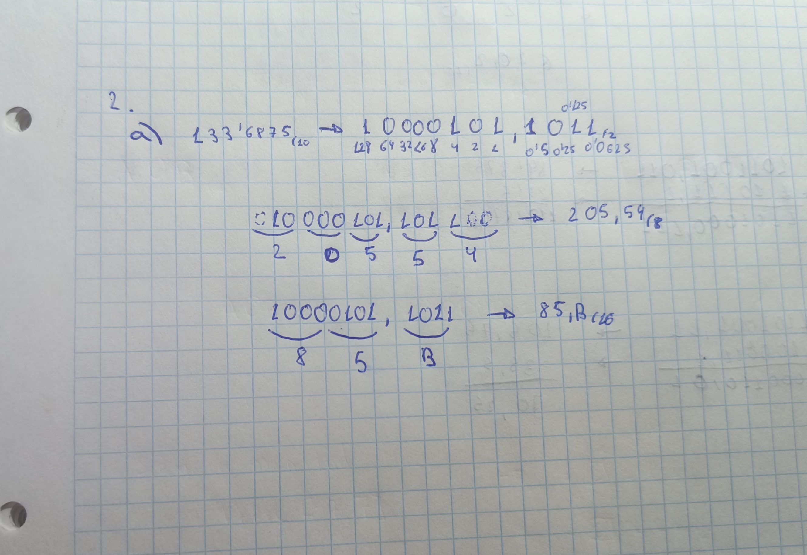
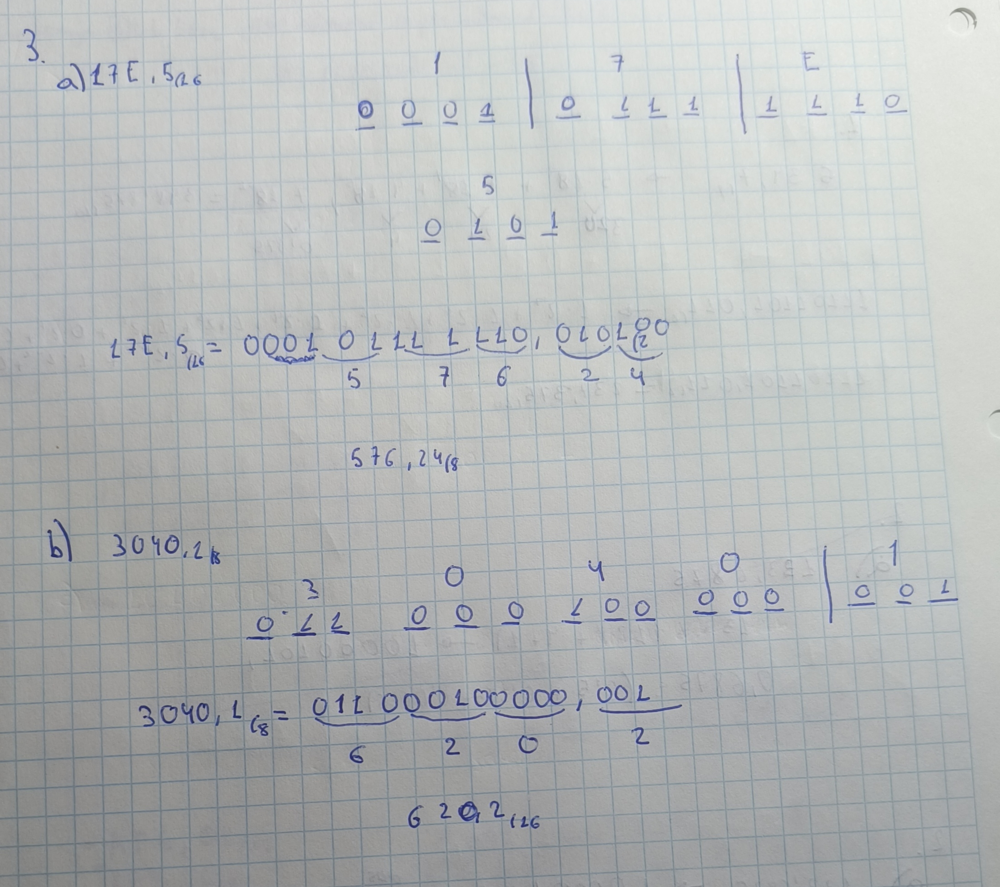
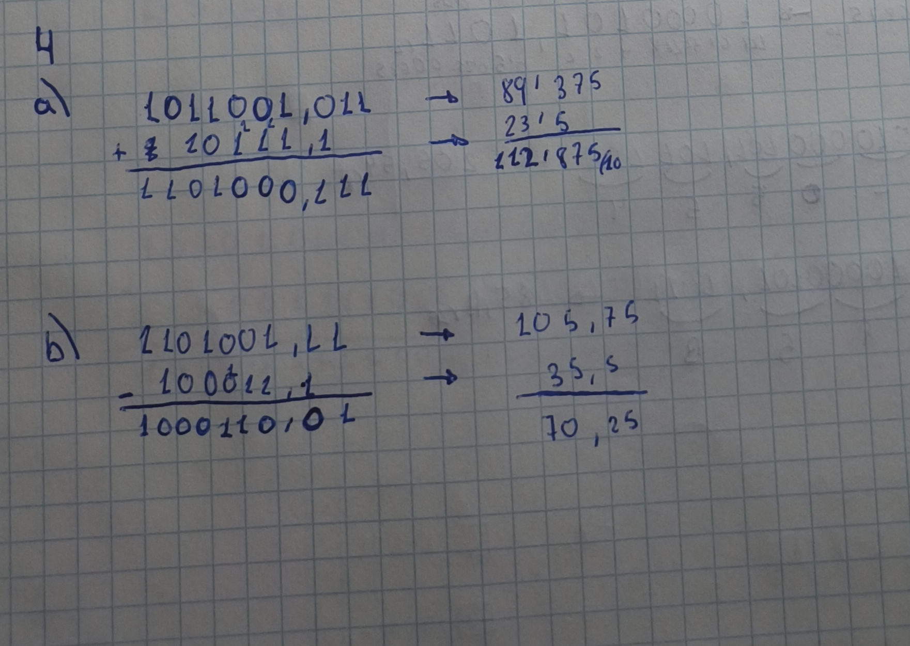
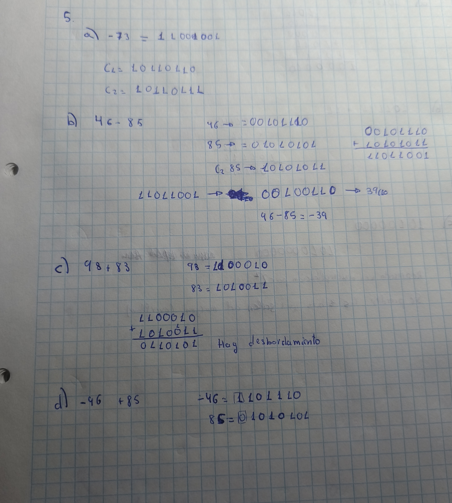
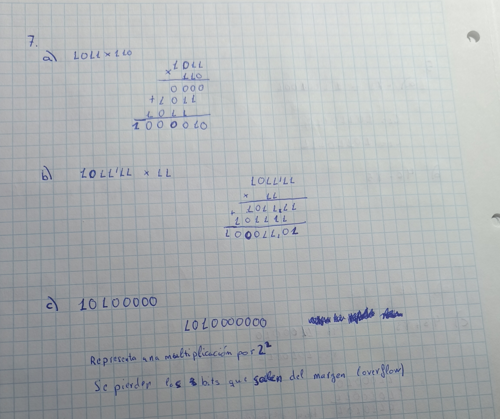
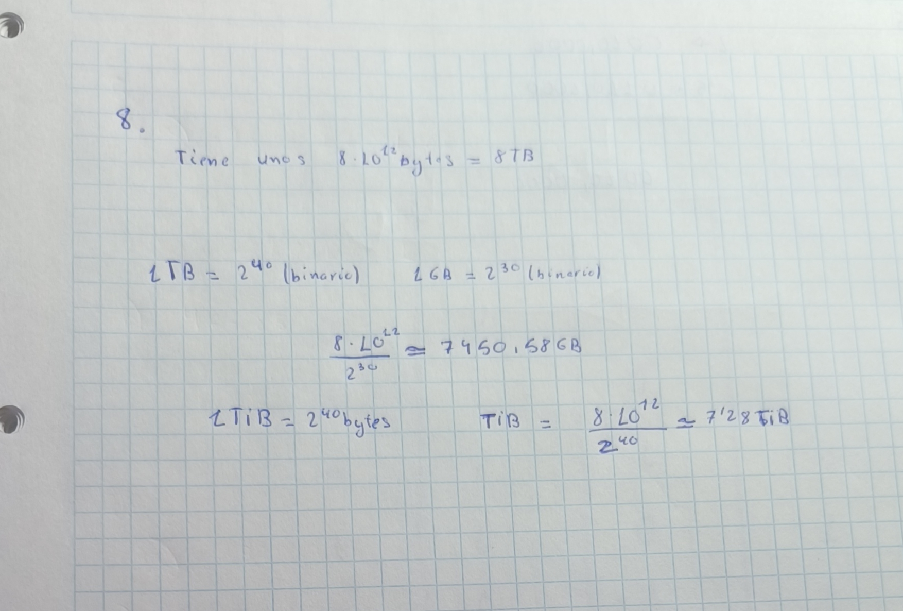
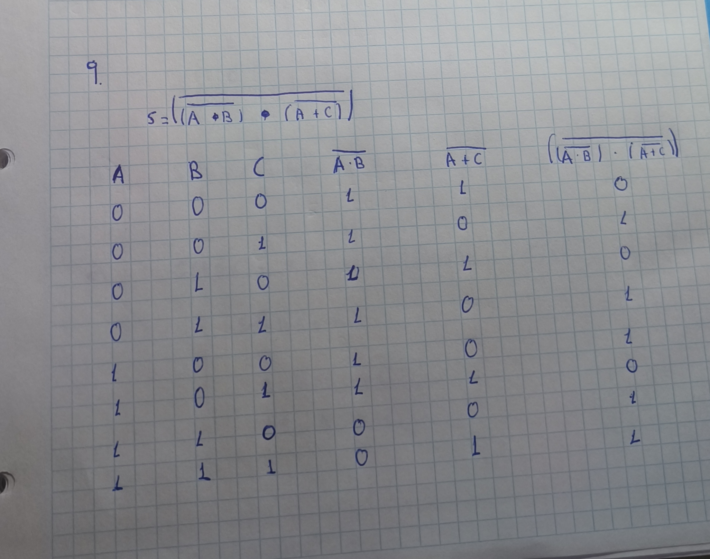
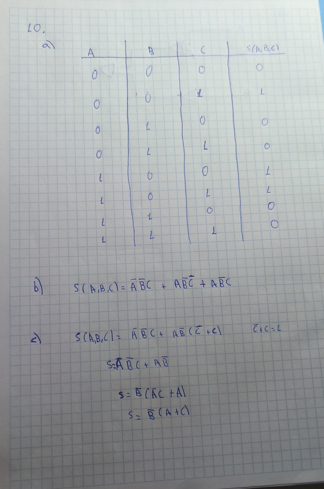

#Relaciónejercicios sitemas informáticos

>@autor:David Membrives Muñoz

##Ejercicio 1

##Ejercicio 2

##Ejercicio 3

##Ejercicio 4

##Ejercicio 5

##Ejercicio 7

##Ejercicio 8

##Ejercicio 9

##Ejercicio 10

.jpg)
